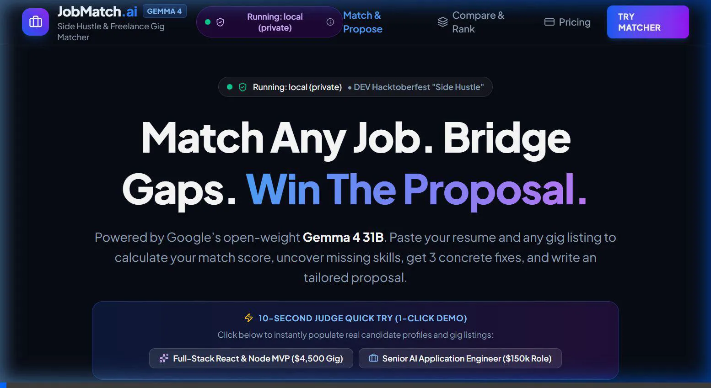
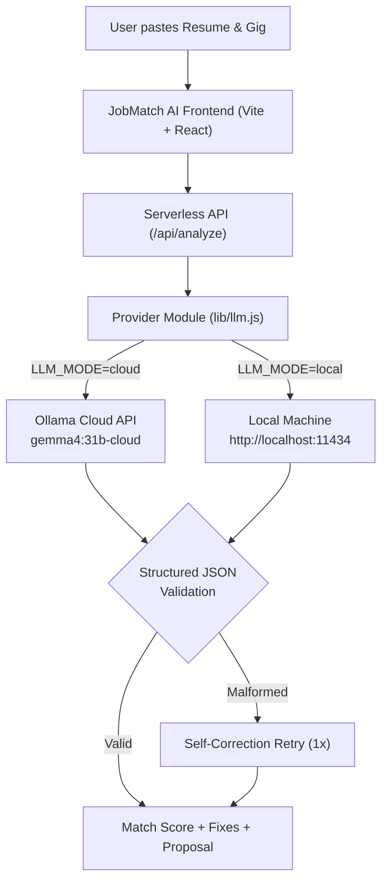

# JobMatch AI — Freelance Gig & Job Matcher
> **DEV Hacktoberfest Open-Source AI Challenge · Week 2 "Side Hustle"**  
> *Powered by Google's open-weight model: **Gemma 4 31B***

[](https://dev.to)
[](https://ollama.com)
[](https://ollama.com)
[](./frontend/test/llm.test.js)
[](https://vercel.com)

JobMatch AI turns the tedious freelance job hunt into an unfair competitive advantage. Built around **Google Gemma 4**, it analyzes candidate resumes against job descriptions or freelance gig postings, calculates a precise match score (0–100), pinpoints missing skills, provides 3 concrete actionable fixes, and crafts tailored, high-converting proposals in the candidate's chosen tone.

---

## 📸 Product Demo & Walkthrough



### Key Features
1. **Match Score & Reasoning:** 0–100 match calibration with concise justification explaining fit.
2. **Skill Gap Diagnostics:** Real-time extraction of matched skills vs. missing requirements.
3. **3 Concrete Things to Fix:** Actionable recommendations to bridge gaps before submitting.
4. **Tailored Proposal Generator:** Custom-tailored Upwork/freelance proposal written in your persona (e.g. Persuasive Freelancer, Technical, Consultative).
5. **Save & Compare Ranking List:** Save multiple gigs to a ranked leaderboard (`/saved`) to prioritize opportunities where your win rate is highest.
6. **10-Second Judge Quick Try:** One-click demo buttons on the home screen to test full-stack developer or AI engineer gig scenarios instantly.
7. **Transparent Pricing:** Free for 3 cloud matches, then scalable paid plans, with **unlimited free matches in Local private mode**.

---

## 🧠 Why Open Models Matter Here

In high-volume job seeking and freelance bidding, the model architecture is not an implementation detail — **the open model is what makes the product work**:

### 1. Cost Per Match vs. Proprietary API Tax
Commercial closed models charge recurring per-token fees for input context and output generation. A thorough evaluation requires sending a full candidate resume (~800–1,500 tokens) alongside a lengthy client RFP (~1,000 tokens), plus generating a structured analysis and proposal (~800 tokens). At scale, proprietary API fees destroy side-hustle unit economics.  
*With Gemma 4:* In Local mode, the cost per match is **$0.00**. In Cloud mode, open weights allow deployment on cost-effective infrastructure with predictable pricing.

### 2. Radical Candidate Data Privacy
Resumes contain highly confidential personal data: full legal names, contact information, employer history, compensation markers, and proprietary project details.  
*Honest Disclosure:*
- **Cloud Mode (`gemma4:31b-cloud`):** Sends resume and gig text securely via HTTPS to Ollama's cloud inference API. Keys are guarded exclusively in serverless backend functions (never exposed to the browser).
- **Local Mode (`gemma4:latest` on `localhost:11434`):** **100% private.** All inference runs on your own GPU/CPU. Candidate data never leaves your laptop.

### 3. Freedom from Vendor Lock-In & Model Portability
Proprietary models are black boxes subject to sudden deprecation, rate limit throttling, and unannounced behavioral shifts. Gemma 4's open weights allow developers to:
- Quantize the model (GGUF 4-bit / 8-bit) for edge laptops.
- Deploy the dense 31B parameter model on dedicated cloud clusters for maximum reasoning.
- Fine-tune on winning freelance proposal corpora without third-party licensing restrictions.

---

## ⚙️ AI Layer Architecture

JobMatch AI features a single provider module ([`frontend/lib/llm.js`](./frontend/lib/llm.js)) with two switchable execution modes controlled via environment variables:



### Structured Output Schema
The model returns strictly validated JSON conforming to:
```json
{
  "match_score": 88,
  "score_reason": "Strong alignment with React and Node, minor gap in Redis caching.",
  "matched_skills": ["React 19", "TypeScript", "Node.js", "Tailwind CSS"],
  "missing_skills": ["Redis Caching", "Docker"],
  "fixes": [
    "Highlight in-memory caching experience in project bullet 1.",
    "Include link to containerized deployment demo.",
    "State availability for immediate sprint kickoff."
  ],
  "cover_letter": "Hi [Client], I saw your listing for..."
}
```
*Resilience:* If initial model output contains markdown codeblocks, trailing commas, or schema violations, the engine cleans the output and triggers an automatic one-time retry with error feedback.

---

## 🚀 Quickstart Guide

### Prerequisites
- **Node.js** (v18+) and **npm**
- (Optional for Local Mode): [Ollama](https://ollama.com) installed on your machine.

---

### Mode 1: Cloud Mode (Gemma 4 31B Cloud)

Cloud mode runs Google's heavy 31B model on Ollama Cloud without requiring local GPU hardware.

1. Clone and enter the repository:
   ```bash
   cd frontend
   npm install
   ```

2. Create `.env` from template:
   ```bash
   cp .env.example .env
   ```

3. Add your Ollama API key in `.env`:
   ```env
   LLM_MODE=cloud
   OLLAMA_API_KEY=your_ollama_api_key_here
   OLLAMA_MODEL=gemma4:31b-cloud
   ```
   *(Get your free key at [ollama.com/settings/keys](https://ollama.com/settings/keys)).*

4. Launch the application:
   ```bash
   npm run dev
   ```
   Open `http://localhost:5173`. You will see the purple badge:  
   `Running: Gemma 4 31B (cloud)`.

---

### Mode 2: Local Mode (100% Private, Zero Data Leaks)

Local mode runs Gemma 4 directly on your laptop so your resume never touches the internet.

1. Start your local Ollama instance with Gemma 4:
   ```bash
   ollama run gemma4
   ```

2. Configure `.env` in `frontend/`:
   ```env
   LLM_MODE=local
   OLLAMA_LOCAL_URL=http://localhost:11434
   OLLAMA_LOCAL_MODEL=gemma4:latest
   ```

3. Launch the web app:
   ```bash
   npm run dev
   ```
   Open `http://localhost:5173`. The green security badge will display:  
   `Running: local (private)`.

---

## 🧪 Automated Testing

The provider switch, JSON schema validation, and retry mechanics are covered by automated unit tests using Node's test runner:

```bash
cd frontend
npm test
```

### Test Coverage Highlights:
- **Test 1: JSON Parsing & Schema Validation:** Verifies structured JSON extraction from raw strings, code fences (````json ... ````), trailing comma sanitation, and boundary score validation.
- **Test 2: Retry Mechanism:** Simulates malformed initial model output, verifying that the provider performs an error-corrected second attempt and succeeds.
- **Test 3: Provider Switch Logic:** Validates proper header injection (`Authorization: Bearer`) and model selection in Cloud mode vs. pure localhost routing in Local mode.

---

## 🚢 Deploying to Vercel

The application is pre-configured for zero-friction Vercel deployment:

1. Push your repository to GitHub.
2. Import the project in the [Vercel Dashboard](https://vercel.com/new).
3. Set the Root Directory to `frontend` (or keep root with included `vercel.json`).
4. Add your Environment Variables in Vercel:
   - `OLLAMA_API_KEY`: Your Ollama Cloud API Key
   - `OLLAMA_MODEL`: `gemma4:31b-cloud`
   - `LLM_MODE`: `cloud`
5. Click **Deploy**. Vercel will build the frontend and serve `/api/analyze` and `/api/status` as serverless functions.

---

## 🏆 Hackathon Submission Checklist

- [x] Built around Google's open-weight model: **Gemma 4 31B**
- [x] Week 2 "Side Hustle" focus (freelancer gig bids, Upwork proposals, job seeker gap closing)
- [x] 0–100 match score + reasoning + matched skills + missing skills + 3 concrete fixes
- [x] Tailored proposal generator with user tone selection
- [x] Save & Compare ranked leaderboard (`/saved`)
- [x] Provider module with Cloud and Local privacy modes
- [x] 10-second Judge Quick Try demo buttons
- [x] Automated unit test suite (`npm test`)
- [x] Vercel serverless deployment architecture
